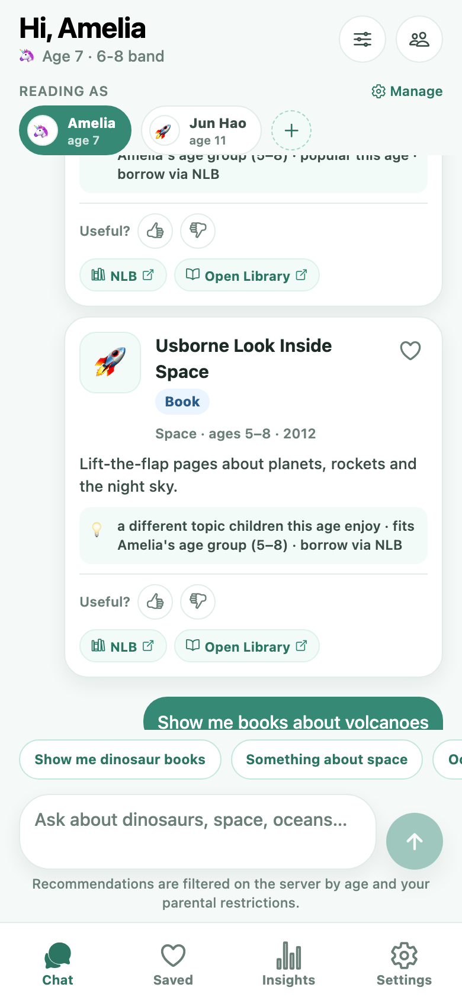
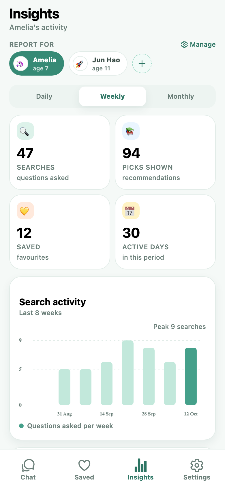
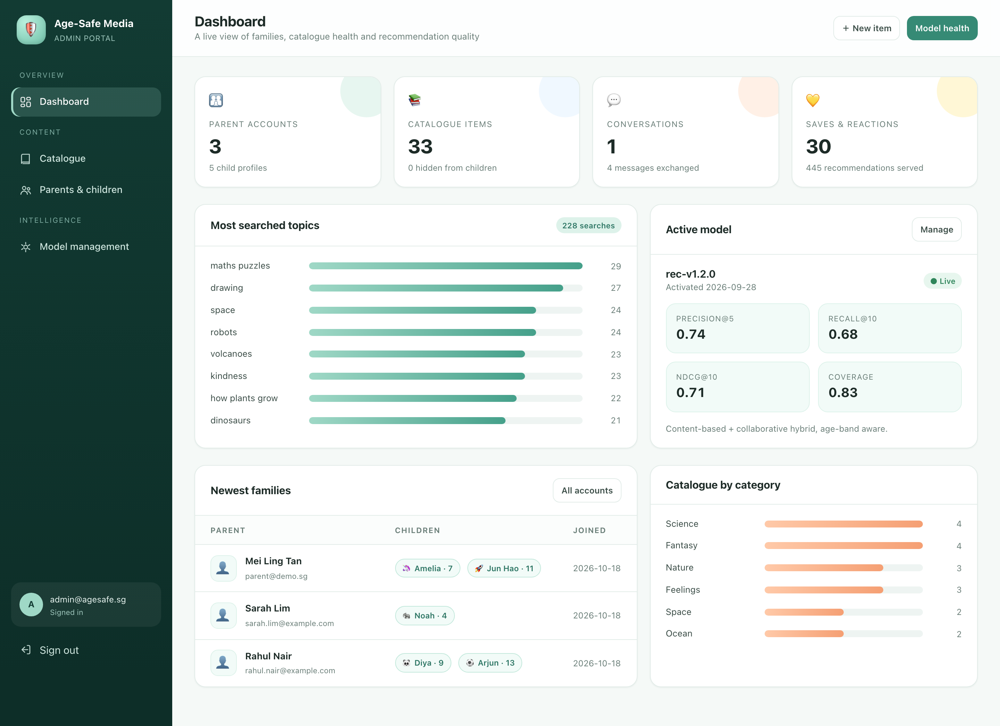

# Age-Safe Conversational Media Recommendation System — Frontend

Final Year Project. **This repository contains the frontend work only:**

1. **Mobile app** — Expo + React Native + TypeScript, iOS and Android from one codebase.
2. **Admin Web Portal** — Jinja2 templates + CSS + vanilla JS (server-rendered, no React web app).

Both talk to the same REST API. A small **dev mock** (`mock-api/`) ships with the repo so the
frontends can be demoed and verified without waiting for the real backend — it is a fixture,
**not a deliverable**, and can be deleted.

| Deliverable | Folder | What it is |
| --- | --- | --- |
| ✅ Mobile app | `mobile/` | Expo Router app: chat, profiles, dashboard, favourites, restrictions |
| ✅ Admin portal | `admin-portal/` | Jinja templates + design system CSS + JS for the admin pages |
| ⚙️ Dev mock (not a deliverable) | `mock-api/` | Reference implementation of the API contract + seeded demo data |
| 🔧 Verification tool | `tools/ui-verify.mjs` | Playwright script that drives the web build and writes screenshots |

| Mobile · chat | Mobile · insights | Admin portal |
| --- | --- | --- |
|  |  |  |

All screenshots: [`docs/screenshots`](docs/screenshots).

---

## 1. Repository layout

```
age-safe-media/
├── mobile/                     ← DELIVERABLE 1 · Expo application
│   ├── src/app/                Expo Router routes
│   │   ├── (auth)/             login · register
│   │   ├── (tabs)/             chat · saved · insights · settings
│   │   ├── children/           list · create · edit (age, avatar, restrictions)
│   │   └── profile-select.tsx  “Who’s reading?”
│   ├── src/components/         12+ reusable components (ui kit, cards, charts, bubbles)
│   ├── src/contexts/           Auth · Children (active profile) · Toast
│   ├── src/services/           API client + one module per resource group
│   ├── src/theme/tokens.ts     design tokens shared with the portal CSS
│   └── src/types/api.ts        TypeScript mirrors of every API response
│
├── admin-portal/               ← DELIVERABLE 2 · frontend files, no Python
│   ├── templates/admin/        base · login · dashboard · catalogue · form · users · models
│   ├── static/css/admin.css    design system + responsive rules
│   ├── static/js/admin.js      drawer, confirm dialogs, flash, live search
│   └── README.md               which context each template needs + how to mount it
│
├── mock-api/                   ← DEV FIXTURE (delete freely)
│   ├── app/                    FastAPI app implementing docs/API.md
│   ├── tests/test_api.py       31 contract tests
│   └── run.sh                  creates a venv and starts on :8000
│
├── docs/                       API contract · iOS/Android testing · checklist · verification
└── tools/ui-verify.mjs         browser verification + screenshot generator
```

---

## 2. Quick start

### 2.1 Mobile app

```bash
cd mobile
npm install
npx expo start            # i = iOS simulator · a = Android emulator · w = web
```

Sign in with the demo account that the mock seeds (pre-filled): `parent@demo.sg` /
`demo1234`. Any other e-mail starts the first-run child-profile flow.

The app auto-detects the API host from the Metro server, so Expo Go on a real phone
works with no configuration. Override with `EXPO_PUBLIC_API_URL` when the backend is
elsewhere (see [docs/TESTING_IOS.md](docs/TESTING_IOS.md) and
[docs/TESTING_ANDROID.md](docs/TESTING_ANDROID.md)).

### 2.2 Admin portal

The portal is frontend files, so something has to render them. Two options:

**A. Use the bundled mock** (fastest way to see it):

```bash
cd mock-api
python3 -m venv .venv && .venv/bin/pip install -r requirements.txt
./run.sh                       # http://127.0.0.1:8000/admin
```

**B. Serve it from your own FastAPI backend**: mount
`admin-portal/static` at `/static` and point `Jinja2Templates` at
`admin-portal/templates`. The required context variables and routes are listed in
[`admin-portal/README.md`](admin-portal/README.md).

Admin login for the mock: `admin@agesafe.sg` / `Admin123!`.

> The mock API and the mobile app must agree on the port. The mobile `.env.example`
> uses `8010`; either run `PORT=8010 ./run.sh` or set `EXPO_PUBLIC_API_PORT=8000`.

### 2.3 Point the app at a different backend

```bash
cd mobile
printf 'EXPO_PUBLIC_API_URL=https://api.example.com\n' > .env
npx expo start -c
```

Nothing else changes — the client only uses the endpoints documented in
[docs/API.md](docs/API.md) and validates no stub-specific behaviour.

---

## 3. The API contract the frontend expects

`docs/API.md` is the source of truth (paths, payloads, auth, error envelope).
Short version:

| Group | Endpoints used by the frontend |
| --- | --- |
| Auth | Firebase ID token in `Authorization: Bearer …` (mobile) · signed cookie (portal) |
| Account | `POST /account/register` · `GET/PATCH /account/me` |
| Children | `GET /children` · `GET /children/meta` · `POST /children` · `GET/PATCH/DELETE /children/{id}` · `PUT /children/{id}/restrictions` |
| Catalogue | `GET /catalogue?q=&ids=` · `GET /catalogue/{id}` |
| Chat | `POST /chat` · `GET /chat/history` · `GET /chat/suggestions` |
| Reports | `GET /reports/activity?child_id=&range=` |
| Favourites | `GET/POST /favourites` · `DELETE /favourites/{item_id}` · `POST /feedback` |
| Admin | `/admin/*` pages + `/admin/api/*` JSON |

**Server-side responsibilities the UI deliberately does not implement:** safety
filtering, age-band filtering, category blocking, ranking, model selection. The app
renders whatever the API returns (plus a visible “blocked by safety filter” state).

---

## 4. Feature coverage

| ID | Feature | Status | Where |
| --- | --- | --- | --- |
| F1 | Conversational interface | ✅ | `(tabs)/index.tsx` + `ChatBubble`, `RecommendationCard` |
| F2 | Account & child profiles | ✅ | `(auth)/*`, `children/*`, `ChildrenContext` |
| F3 | Explainable recommendations | ✅ | `RecommendationCard` (matched tags, why, `topic`/`discovery`) |
| F5 | Parent dashboard | ✅ | `(tabs)/dashboard.tsx` + `charts.tsx` |
| F7 | Output customisation | ✅ | preferences sheet + per-child persistence |
| F8 | Favourites & feedback | ✅ | `(tabs)/favourites.tsx`, optimistic toggles |
| F9 | Admin portal | ✅ | `admin-portal/templates/admin/*` |
| F10 | External links | ✅ | NLB / Open Library via `Linking` |
| F12 | Parental restrictions | ✅ | `children/[id].tsx` + `ChildFormPieces` |
| F13 | Child profile switching | ✅ | `ChildSwitcher`, `profile-select.tsx` |
| F14 | Admin user management | 🟡 | read-only by design (`users.html`) |
| F15 | Admin model management | 🟡 | metrics + retrain request + activation |

Full breakdown incl. mocked areas: [docs/FEATURES_CHECKLIST.md](docs/FEATURES_CHECKLIST.md).

---

## 5. Configuration

### Mobile (`mobile/.env`)

| Variable | Purpose |
| --- | --- |
| `EXPO_PUBLIC_API_URL` | explicit API base URL (wins over auto-detection) |
| `EXPO_PUBLIC_API_PORT` | port for auto-detection (default `8010`) |
| `EXPO_PUBLIC_FIREBASE_API_KEY` · `…AUTH_DOMAIN` · `…PROJECT_ID` · `…APP_ID` | enable real Firebase Auth |

Without the Firebase variables the app uses a **local demo session** and says so in
the UI (badge “Demo auth”, note on the login screen). Only `EXPO_PUBLIC_*` values are
bundled; service-account keys never are.

### Portal

No build step and no environment specific values inside the templates — the backend
supplies `admin_email`, `settings`, `flash` and the page data.

---

## 6. Testing

```bash
# API contract, exercised against the bundled mock (31 tests)
cd mock-api && .venv/bin/python -m pytest tests -q

# type safety of the whole mobile app
cd mobile && npx tsc --noEmit

# browser UI verification + screenshots (needs both servers running)
cd tools && npm i playwright && npx playwright install chromium && cd ..
node tools/ui-verify.mjs
```

The UI script signs in, sends a chat message, asserts recommendation cards render,
saves a favourite and finds it on the Saved tab, checks the dashboard and settings,
opens the child editor and the preferences sheet, and fails on any console error.
Last run: **10/10 checks passed**. Details in
[docs/VERIFICATION.md](docs/VERIFICATION.md).

---

## 7. Design system

Tokens in `mobile/src/theme/tokens.ts` are mirrored at the top of
`admin-portal/static/css/admin.css`:

* **Palette** — mint `#45A08A` primary, peach/sky/lemon accents, ink `#1D2B27`, canvas `#F5F9F7`.
* **Shape** — 10/14/20/26 px radii, soft shadows, 4→36 px spacing scale.
* **Type** — 30/24/19/16/15/13/11.5 px, tight tracking on headings.
* **States** — loading / empty / error+retry on every data screen.
* **Accessibility** — 44 px targets, roles/labels/states on controls, layout that
  survives large font scales; the CSS respects `prefers-reduced-motion`.

The mobile app is phone-first but centres content at 720 pt on tablets; the portal is
desktop-first with a drawer, stacked cards and scrollable tables under 860 px.

---

## 8. Scope notes

* **Frontend only** — no ML pipeline, no model training, no production backend.
* `mock-api/` exists so the app can be demoed; deleting it leaves both frontends
  intact (they will show their empty/error states until a real API is configured).
* The deterministic “recommender” inside the mock is a placeholder that honours the
  contract; the real system swaps it out without frontend changes.
* Admin user management is read-only; destructive account operations intentionally
  stay on the backend.
* Firebase is optional at runtime; production needs a Firebase project and
  `DEV_AUTH=false` on the API.

## 9. Documentation

| Document | Contents |
| --- | --- |
| [docs/API.md](docs/API.md) | Endpoint reference, auth, request/response schemas, error envelope |
| [admin-portal/README.md](admin-portal/README.md) | How to serve the templates + context variables per page |
| [docs/TESTING_IOS.md](docs/TESTING_IOS.md) | Simulator, Expo Go, dev build, API URL on device, safe area, test script |
| [docs/TESTING_ANDROID.md](docs/TESTING_ANDROID.md) | Emulator (`10.0.2.2`), `adb reverse`, cleartext config, test script |
| [docs/FEATURES_CHECKLIST.md](docs/FEATURES_CHECKLIST.md) | Delivered vs mocked vs still-backend |
| [docs/VERIFICATION.md](docs/VERIFICATION.md) | What was run and what passed |
